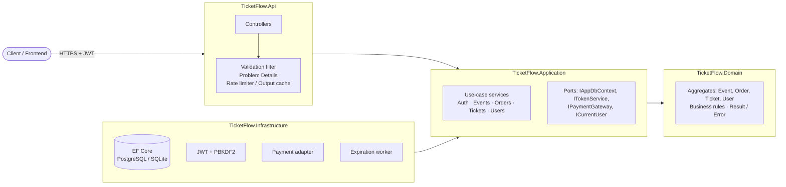
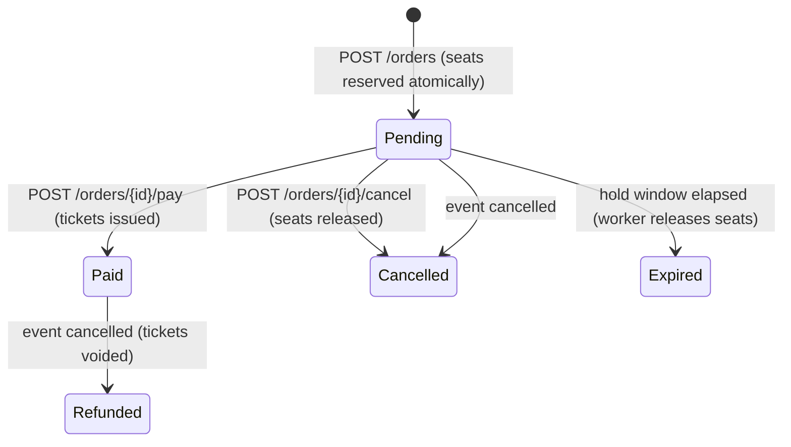

# TicketFlow API


[](https://github.com/Mastena12/ticketflow-api/actions/workflows/ci.yml)


A production-style **event ticketing REST API** built with ASP.NET Core 10 and Clean Architecture.

Selling tickets looks like simple CRUD. The hard part shows up when 10,000 people try to buy the last 50 seats in the same second. TicketFlow is built around those problems:

| Problem | How TicketFlow solves it |
|---|---|
| **Overselling** under concurrent load | Seats are reserved with a single atomic, conditional `UPDATE ... WHERE Sold + n <= Capacity`. No locks in the app, no `SERIALIZABLE` isolation. A DB check constraint backs it up. |
| **Duplicate orders** from network retries / double clicks | `Idempotency-Key` header. A retry returns the original order (`Idempotent-Replayed: true`) and does not reserve seats again. A unique index handles the race. |
| **Abandoned carts** holding seats forever | Reservations expire after 10 minutes. A background worker returns the seats, and optimistic concurrency makes it safe to run on many instances. |
| **Lost updates** (pay vs. expire vs. cancel racing) | Every aggregate has a concurrency token. The losing writer gets `409`, and a payment already charged is refunded. |
| **Stolen refresh tokens** | Refresh tokens rotate on every use, and only their hash is stored. Reusing an old token **revokes the whole session family**. |
| **Double entry** at the venue gate | A ticket can be checked in exactly once, even when two gates scan it at the same moment. |
| **Brute force / ticket bots** | Rate limits: a fixed window per IP on auth, and a token bucket per user on ordering. |

---

## Tech stack

- **.NET 10 (LTS)** · ASP.NET Core Web API · C# 14
- **EF Core 10**: PostgreSQL (Npgsql) in production, SQLite for zero-setup local runs and tests
- **JWT** bearer auth with refresh-token rotation · role-based authorization (Customer / Organizer / Admin)
- **FluentValidation** · **RFC 9457 Problem Details** for every error
- **Serilog** structured logging with correlation ids
- Built-in **OpenAPI 3.1** + **Scalar** interactive docs
- Rate limiting, output caching with tag eviction, health checks (liveness / readiness)
- **xUnit**: unit tests + integration tests on the real HTTP pipeline (`WebApplicationFactory`), with a fake clock
- **Docker** (multi-stage, non-root) · **docker-compose** with PostgreSQL · **GitHub Actions** CI
- Central Package Management, warnings-as-errors, .NET analyzers

## Architecture



Dependencies point inward. **Domain** has no dependencies. **Application** holds the use cases and defines ports. **Infrastructure** implements those ports, and **Api** is the thin HTTP layer.

```
src/
  TicketFlow.Domain/          Entities, invariants, domain errors, Result type
  TicketFlow.Application/     Use-case services, DTOs, validators, abstractions
  TicketFlow.Infrastructure/  EF Core (configs, migrations, seeding), JWT, hashing, payments, background jobs
  TicketFlow.Api/             Controllers, auth, rate limiting, caching, OpenAPI, error handling
tests/
  TicketFlow.UnitTests/         Domain rules and security primitives
  TicketFlow.IntegrationTests/  End-to-end HTTP tests incl. a concurrency (oversell) test
```

### Order lifecycle



## Getting started

### Option 1: run locally (no database install needed)

Requirements: [.NET 10 SDK](https://dotnet.microsoft.com/download/dotnet/10.0).

```bash
dotnet run --project src/TicketFlow.Api
```

Open **http://localhost:5137** to get the interactive API reference (Scalar). A SQLite database is created and seeded automatically.

### Option 2: Docker with PostgreSQL

```bash
docker compose up --build
```

Open **http://localhost:8080**. EF Core migrations are applied on startup.

### Demo accounts

| Role | Email | Password |
|---|---|---|
| Admin | `admin@ticketflow.dev` | `Passw0rd!` |
| Organizer | `organizer@ticketflow.dev` | `Passw0rd!` |
| Customer | `customer@ticketflow.dev` | `Passw0rd!` |

A step-by-step walkthrough lives in [`requests/demo.http`](requests/demo.http). It runs directly in VS Code (REST Client) or Rider/Visual Studio.

## API overview

All endpoints are versioned under `/api/v1`. Errors are always `application/problem+json` with a stable machine-readable `code` (e.g. `Order.SoldOut`).

| Method | Endpoint | Access | Description |
|---|---|---|---|
| POST | `/auth/register` | public | Create a customer account |
| POST | `/auth/login` | public | Get access + refresh token |
| POST | `/auth/refresh` | public | Rotate refresh token |
| POST | `/auth/logout` | user | Revoke refresh token |
| GET | `/auth/me` | user | Current profile |
| GET | `/events` | public | Search catalogue (filter, sort, paging, cached) |
| GET | `/events/{id}` | public | Event details with live availability |
| GET | `/events/managed` | organizer | Own events in every status |
| POST | `/events` | organizer | Create draft event with tiers |
| PUT | `/events/{id}` | organizer | Update event |
| POST | `/events/{id}/ticket-tiers` | organizer | Add a ticket tier |
| POST | `/events/{id}/publish` | organizer | Put event on sale |
| POST | `/events/{id}/cancel` | organizer | Cancel event, refund buyers |
| GET | `/events/{id}/sales-report` | organizer | Sold / reserved / checked-in / revenue per tier |
| POST | `/orders` | user | Reserve seats (`Idempotency-Key` supported) |
| POST | `/orders/{id}/pay` | user | Pay and issue tickets |
| POST | `/orders/{id}/cancel` | user | Cancel and release seats |
| GET | `/orders`, `/orders/{id}` | user | Order history |
| GET | `/tickets`, `/tickets/{code}` | user | My tickets |
| POST | `/tickets/check-in` | organizer | Admit a ticket holder (once) |
| GET | `/users` · PUT `/users/{id}/role` | admin | User administration |
| GET | `/health/live`, `/health/ready` | public | Liveness / readiness probes |

Payments go through a fake gateway with Stripe-style test tokens. Any token succeeds except `tok_declined` and `tok_insufficient_funds`.

## Design decisions

<details>
<summary><b>Why an atomic conditional UPDATE instead of locking?</b></summary>

The obvious approach is to read `Sold`, check it in C#, then write `Sold + n`. That is a race: two requests can both read `Sold = 49` and both sell seat #50. TicketFlow sends one statement instead:

```sql
UPDATE "TicketTiers" SET "Sold" = "Sold" + @n
WHERE "Id" = @tier AND "Sold" + @n <= "Capacity"
  AND EXISTS (SELECT 1 FROM "Events" e WHERE e."Id" = "EventId" AND e."Status" = 'Published')
```

The database evaluates the condition and applies the write under a row lock. If zero rows are affected, the tier is sold out. The statement needs no distributed lock, no retries and no `SERIALIZABLE` isolation, and it scales across API instances. The integration test `Concurrent_buyers_can_never_oversell_a_tier` fires 25 simultaneous purchases at 5 seats and asserts that exactly 5 succeed.
</details>

<details>
<summary><b>Why Result objects instead of exceptions?</b></summary>

"Sold out" or "already checked in" are normal outcomes, not exceptional ones. Services return `Result<T>` with a typed `Error` (`Validation`, `NotFound`, `Conflict`, `PaymentRequired`, and so on), and the API maps each error to the right status code and Problem Details response. Exceptions are reserved for real failures and go through a global `IExceptionHandler` that never leaks internals.
</details>

<details>
<summary><b>Why no MediatR / generic repository?</b></summary>

EF Core's `DbContext` already implements the Unit-of-Work and Repository patterns. Plain use-case services keep the call stack easy to follow and debug, and avoid an extra commercial dependency (MediatR switched to a commercial license in 2025). The Application layer depends only on an `IAppDbContext` port.
</details>

<details>
<summary><b>Two database providers?</b></summary>

PostgreSQL is the production database, and its schema is managed by EF Core migrations. SQLite gives contributors and reviewers a zero-install `dotnet run`, and it keeps the test suite fast. Provider differences (decimal and `DateTimeOffset` ordering) are handled with value conversions that apply only on SQLite. CI runs the **entire integration suite against both providers**.
</details>

<details>
<summary><b>Other details worth noting</b></summary>

- **UUIDv7 keys** (`Guid.CreateVersion7()`): generated in the domain but time-ordered, so B-tree indexes stay compact.
- **Snapshot pricing**: order items copy the tier name and price, so history never changes retroactively.
- **Draft events and other users' orders return 404, not 403**, so ids cannot be probed.
- **Login timing**: an unknown email costs the same PBKDF2 work as a wrong password, which stops user enumeration through timing.
- **Testable time**: everything uses `TimeProvider`, including JWT lifetime validation. Tests move the clock forward to expire reservations deterministically.
- **Lazy configuration**: DB provider, JWT and rate-limit settings are resolved from options at runtime, so env vars and test overrides always apply.
</details>

## Testing

```bash
dotnet test
```

- **24 unit tests**: domain invariants (scheduling, publishing, order state machine, ticket check-in), JWT and password hashing.
- **28 integration tests**: they boot the real API in memory and cover auth flows (rotation and reuse detection), RBAC, catalogue caching, the full purchase flow, **concurrent overselling**, idempotency, payment failures, reservation expiry, event cancellation and refunds, rate limiting, health checks and the OpenAPI document.

To run the integration tests against PostgreSQL (CI does this automatically):

```bash
TICKETFLOW_TEST_POSTGRES="Host=localhost;Username=postgres;Password=postgres" dotnet test tests/TicketFlow.IntegrationTests
```

## Configuration

| Key | Default | Description |
|---|---|---|
| `Database:Provider` | `Sqlite` | `Sqlite` or `Postgres` |
| `ConnectionStrings:Postgres` | | PostgreSQL connection string |
| `Database:SeedDemoData` | `true` | Seed demo users and events into an empty DB |
| `Jwt:Secret` | dev only | HMAC key, at least 32 characters. **Set via env var / secrets in production** (`Jwt__Secret`) |
| `Jwt:AccessTokenMinutes` / `RefreshTokenDays` | `15` / `7` | Token lifetimes |
| `Ticketing:ReservationHoldMinutes` | `10` | How long unpaid seats are held |
| `Ticketing:MaxTicketsPerOrder` | `10` | Anti-scalping limit |
| `RateLimiting:*` | | Auth window and ordering token bucket |

## Roadmap

- Outbox pattern and e-mail/PDF ticket delivery
- QR code rendering for tickets
- Real payment provider adapter (Stripe / iyzico) with webhooks
- Distributed cache (Redis) for the catalogue
- OpenTelemetry traces and metrics

## License

MIT
